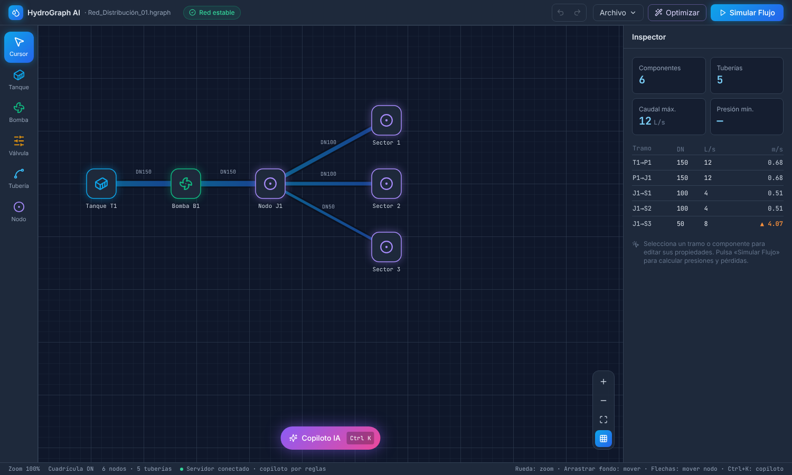
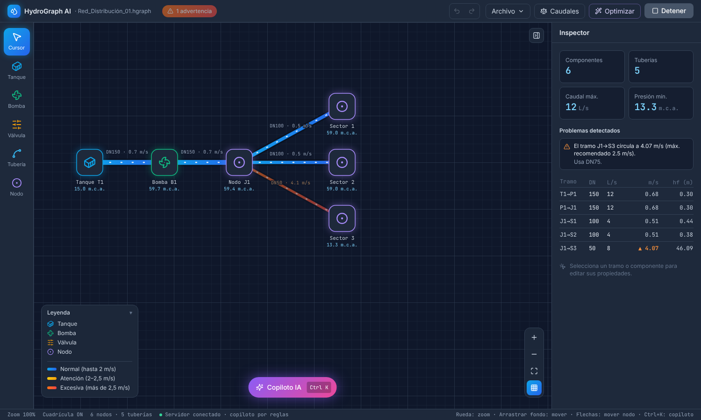
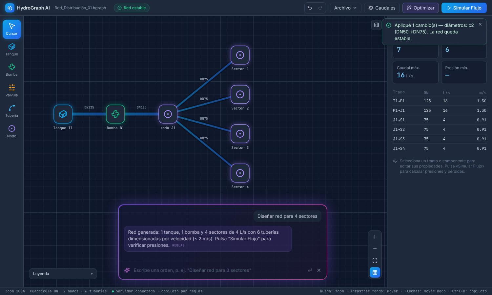
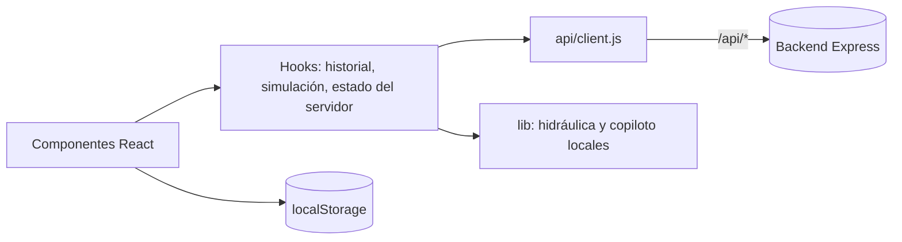

# HydroGraph AI — Frontend

Editor visual para **diseñar, simular y auditar redes de suministro de agua** con ayuda de IA. Proyecto final de _Diseño de Interfaces_.



> Backend (API de simulación y copiloto): [Proyectos-de-interfaces-EB](https://github.com/Juanda-11/Proyectos-de-interfaces-EB)

## Qué se puede hacer

- **Dibujar la red**: tanques, bombas, válvulas, nodos y tuberías; arrastrar con imán a la cuadrícula (opcional), mostrar u ocultar la cuadrícula, zoom, desplazamiento, **encuadrar toda la red**, pantalla completa y deshacer/rehacer.
- **Simular el flujo**: velocidades, pérdidas de carga (Hazen-Williams) y presiones calculadas por el backend, con alertas visuales, tuberías coloreadas por velocidad y leyenda plegable y lista de problemas que lleva al elemento afectado.
- **Copiloto IA** (`Ctrl+K`): _«Diseñar red para 4 sectores»_, _«Auditar presiones»_. Usa **Gemini** (clave gratuita) o Claude si el backend tiene clave; si no, un motor por reglas.
- **Calcular caudales** (botón _Caudales_): reparte las demandas de los nodos por los tramos de la red.
- **Optimizar** con un clic: corrige diámetros con velocidad excesiva y sube la altura de bombas si falta presión.
- **Importar/exportar**: JSON propio, **EPANET (.inp)**, el diagrama como **SVG/PNG** y un **informe técnico en Markdown**.
- **Idioma español/inglés** y **tema claro/oscuro**: se recuerdan entre sesiones y también se traducen los mensajes del servidor.
- **Guardado automático** en el navegador y **modo sin conexión**: si el backend no responde, el editor sigue funcionando con cálculo local de velocidades.
- **Accesible**: todo el lienzo se maneja con teclado (Tab, Enter, flechas), foco visible, etiquetas ARIA y respeto a `prefers-reduced-motion`.

| Simulación y problemas detectados              | Copiloto                                   |
| ---------------------------------------------- | ------------------------------------------ |
|  |  |

## Ejecutar en local

Necesitas Node 20 o superior.

```bash
# 1) Backend (en el otro repositorio)
git clone https://github.com/Juanda-11/Proyectos-de-interfaces-EB && cd Proyectos-de-interfaces-EB
npm install && npm run dev            # http://localhost:3001

# 2) Frontend
git clone https://github.com/Juanda-11/Proyectos-de-interfaces-E && cd Proyectos-de-interfaces-E
npm install && npm run dev            # http://localhost:5173
```

En desarrollo, Vite redirige `/api` a `http://localhost:3001` (configurable con `BACKEND_URL`). Sin backend la aplicación abre igual, en modo local.

## Variables de entorno

| Variable       | Cuándo             | Descripción                                                                             |
| -------------- | ------------------ | --------------------------------------------------------------------------------------- |
| `VITE_API_URL` | Compilación        | URL del backend desplegado, sin barra final. Vacía = mismo origen / proxy de desarrollo |
| `BACKEND_URL`  | Solo `npm run dev` | Destino del proxy de desarrollo (por defecto `http://localhost:3001`)                   |

## Despliegue en Vercel

1. El [backend](https://github.com/Juanda-11/Proyectos-de-interfaces-EB#despliegue-en-vercel) se despliega primero y su URL se usa en el paso 3.
2. En Vercel: **Add New → Project** → importa este repositorio (se detecta Vite; [`vercel.json`](vercel.json) ya fija el comando de instalación y las cabeceras de seguridad).
3. En _Environment Variables_ añade `VITE_API_URL` = URL del backend (p. ej. `https://hydrograph-api.vercel.app`).
4. La URL resultante del frontend se configura en `CORS_ORIGINS` del backend, que se vuelve a desplegar.

Guía completa, con comprobaciones y diagnóstico: [`docs/DEPLOY.md`](docs/DEPLOY.md).

## Scripts

| Comando                                                 | Descripción                                           |
| ------------------------------------------------------- | ----------------------------------------------------- |
| `npm run dev`                                           | Servidor de desarrollo con recarga en vivo            |
| `npm run build` / `npm run preview`                     | Compilación de producción y vista previa              |
| `npm test` / `npm run coverage`                         | Pruebas (Vitest + Testing Library) y cobertura        |
| `npm run lint` / `npm run format`                       | ESLint y Prettier                                     |
| `npm run check`                                         | Lint + formato + pruebas (lo mismo que ejecuta la CI) |
| `npm run electron:dev`                                  | Ventana de escritorio (Electron) con recarga en vivo  |
| `npm run desktop:win` · `desktop:mac` · `desktop:linux` | Instaladores de escritorio en `release/`              |

## Versión de escritorio

Instaladores para **Windows, macOS y Linux** (Electron + electron-builder), generados desde _Actions → Desktop → Run workflow_ o con `npm run desktop:win | desktop:mac | desktop:linux`. Detalles, avisos de seguridad del sistema operativo y funcionamiento en [`docs/DESKTOP.md`](docs/DESKTOP.md).

## Atajos

| Acción                              | Atajo                                              |
| ----------------------------------- | -------------------------------------------------- |
| Copiloto                            | `Ctrl/⌘ + K` (cerrar: `Esc`)                       |
| Deshacer / Rehacer                  | `Ctrl/⌘ + Z` / `Ctrl/⌘ + Y` o `Ctrl/⌘ + Shift + Z` |
| Eliminar selección                  | `Supr` / `Retroceso`                               |
| Quitar selección y volver al cursor | `Esc`                                              |
| Mover un nodo enfocado              | Flechas (una celda de la cuadrícula)               |
| Zoom / desplazar                    | Rueda / arrastrar el fondo                         |

## Arquitectura



Más detalle en [`docs/ARCHITECTURE.md`](docs/ARCHITECTURE.md).

```
src/
├── App.jsx                 # Composición: estado global, acciones y atajos
├── api/client.js           # Cliente HTTP con errores tipados y timeout
├── components/             # TopBar, Toolbar, Canvas, Inspector, Copilot, FileMenu, Toasts…
├── hooks/                  # useNetworkHistory, useSimulation, useBackendStatus, useToasts
└── lib/                    # hidráulica local, red demo, validación/importación,
                            # almacenamiento, exportación (SVG/PNG), copiloto sin conexión
electron/main.js            # Ventana de escritorio
```

## Pruebas

Más de 200 pruebas cubren la lógica (`lib/`, hooks, cliente HTTP) y la interfaz (componentes y flujos completos de `App` con el backend simulado). La CI ejecuta lint, formato, cobertura y build en Node 20 y 22.

## Material de presentación

[`docs/GUIA_SUSTENTACION.md`](docs/GUIA_SUSTENTACION.md): resumen del proyecto, decisiones de diseño, demostración sugerida y preguntas frecuentes.

## Licencia

MIT
